# Product reconstruction dossiers

This directory is the product-level map between the retained historical source
pool and the public rsomics portfolio.

A dossier is an implementation contract, not a promise that every historical
operation will ship. It records:

- upstream scope and user-recognizable operations;
- overlapping implementations and the selected canonical operation;
- historical code, test, fixture, and benchmark assets;
- target subcommands and internal modules;
- public-foundation consumers;
- compatibility and performance gates;
- explicit exclusions and staged release slices.

## Portfolio map

| Product | Source candidates | Dossier state |
|---|---:|---|
| `rsomics-annotation` | 4 | [released 0.1.0](interval-annotation-index.md#rsomics-annotation) |
| `rsomics-bam` | 41 | [released 0.29.0](bam.md) |
| `rsomics-bed` | 42 | [GitHub 0.2.0 released and public install verified; registry remains 0.1.0](bed.md) |
| `rsomics-call` | 2 | [released 0.1.3](variant.md#rsomics-call) |
| `rsomics-cnv` | 2 | [released 0.1.0](variant.md#rsomics-cnv) |
| `rsomics-composition` | 10 | [released 0.1.0](composition.md) |
| `rsomics-count` | 4 | [GitHub 0.1.0 native/source delivery and public install verified; immutable registry archive is separate](count.md) |
| `rsomics-deseq` | 12 | [GitHub 0.1.0 released and public install verified; registry held](bulk-expression.md#rsomics-deseq) |
| `rsomics-ecology` | 19 | [GitHub 0.1.0 released and public install verified; registry held](ecology.md) |
| `rsomics-edger` | 17 | [private modern QL workflow; numerical contract held](bulk-expression.md#rsomics-edger) |
| `rsomics-fastq-preprocess` | 12 | [released 0.1.1](fastq-preprocess-gate-2026-07-30.md) |
| `rsomics-fastq-qc` | 1 | [released 0.1.0](fastq-qc-gate-2026-08-02.md) |
| `rsomics-index` | 5 | [native4 and full workflow correctness accepted; complete performance result retains failed binary-serial gate](interval-annotation-index.md#rsomics-index) |
| `rsomics-liftover` | 1 | [released 0.1.0](liftover.md) |
| `rsomics-limma` | 16 | [GitHub 0.1.0 released and public install verified; registry held](bulk-expression.md#rsomics-limma) |
| `rsomics-metagenomics` | 5 | [released 0.1.0](metagenomics-gate-2026-08-02.md) |
| `rsomics-methyl` | 1 | [released 0.1.0](methyl.md) |
| `rsomics-minimap2` | 1 | [legacy wrapper; exact engine/lifetime and material product-value gates held](minimap2.md) |
| `rsomics-peak` | 5 | [private native4/source/full-workflow performance accepted; public default held](peak.md) |
| `rsomics-phylo` | 11 | [released 0.1.0](phylo.md#first-release-evidence) |
| `rsomics-plink` | 42 | [green15 native/source accepted; new-binary workflow measurement pending, earlier incremental RSS evidence and upstream-negative whole/publication gates retained](genotype-popgen.md#rsomics-plink) |
| `rsomics-popgen` | 14 | [GitHub 0.1.0 released and public install verified; registry held](genotype-popgen.md#rsomics-popgen) |
| `rsomics-rnaseq-qc` | 21 | [GitHub 0.1.0 released and public install verified; registry held](rnaseq-qc-signal.md#rsomics-rnaseq-qc) |
| `rsomics-sc` | 29 | [private inferCNV candidate; discovery contract held](sc.md) |
| `rsomics-seq` | 34 | [released 0.2.0](sequence-fastq.md#rsomics-seq) |
| `rsomics-signal` | 15 | [six-operation source/native4 accepted; defect repairs approved, row-order/performance held](rnaseq-qc-signal.md#rsomics-signal) |
| `rsomics-sketch` | 1 | [GitHub 0.1.1 corrected delivery and public install verified; registry held](metagenomics-sketch.md) |
| `rsomics-structure` | 9 | [reviewed private analysis/native4; public torsion contract held](structure.md) |
| `rsomics-table` | 16 | [GitHub 0.1.0 released and public install verified; registry held](table.md) |
| `rsomics-vcf` | 30 | [registry 0.5.0; corrected private integration native4 accepted, policy/performance/public delivery gates remain; frozen 0.6.0 must not publish unchanged](variant.md#rsomics-vcf) |

Counts are generated from
[`portfolio-inventory.tsv`](../00-overview/portfolio-inventory.tsv). They
describe recoverable inputs, not planned subcommand counts.

All 30 accepted product boundaries now have a source and upstream-operation
dossier. An audited dossier authorizes reconstruction work; it does not mean
the product or every listed operation is implemented or release-ready.
Current family states and original receipts in `.autopilot/state` and
`.autopilot/oracles` own detailed acceptance boundaries. A GitHub binary/source
release does not replace an immutable crates.io archive, and a first-slice
release does not complete every later operation in its dossier.

## Rejected public boundary

| Former candidate | Source candidates | Decision |
|---|---:|---|
| `rsomics-workflow` | 1 | [rejected](workflow.md); the sample-sheet asset is consumer-specific metadata validation, not a workflow product |
| `rsomics-expression` | 2 | [rejected](bulk-expression.md#rejected-rsomics-expression-boundary); count-matrix collation belongs to `rsomics-count`, and significance labels are product-local reporting |

## Relationship map

```mermaid
flowchart TB
    subgraph sequence["Sequence and FASTQ pilot"]
        seq["rsomics-seq"]
        prep["rsomics-fastq-preprocess"]
        qc["rsomics-fastq-qc"]
        sketch["rsomics-sketch"]
        meta["rsomics-metagenomics"]
    end

    subgraph interval["Interval and annotation pilot"]
        bed["rsomics-bed"]
        annotation["rsomics-annotation"]
        index["rsomics-index"]
        liftover["rsomics-liftover"]
    end

    common["rsomics-common"] --> seq
    common --> prep
    common --> bed
    common --> annotation
    common --> liftover
    common --> qc
    common --> sketch
    common --> meta
    common --> index
    help["rsomics-help"] --> seq
    help --> prep
    help --> bed
    help --> annotation
    help --> liftover
    help --> qc
    help --> sketch
    help --> meta
    help --> index
    seqio["rsomics-seqio"] --> seq
    seqio --> prep
    seqio --> qc
    seqio --> sketch
    seqio --> meta
    seqio -. planned .-> index
    kmer["rsomics-kmer"] --> seq
    kmer --> sketch
    kmer -. planned .-> meta
    intervals["rsomics-intervals"] --> bed
    intervals --> annotation
    intervals --> liftover
```

Solid arrows are current consumer contracts. Dotted arrows are planned
consumers and do not justify a public API by themselves. None implies that a
foundation API is already stable.
