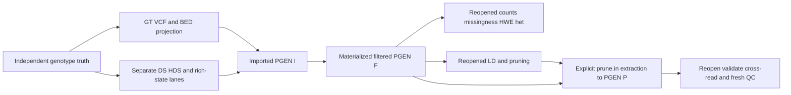

# PLINK shared-fileset source-oracle plan

## Adopted scope

Prepare one real hosted Linux x86_64 source/runtime-qualified casebook for the
existing genotype-QC/LD-preparation product. No Rust owner, public crate,
foundation, production codec choice or release is authorized by this source
capture alone. The public product remains the planned make/stats/ld family,
not six micro-crates or six separately installed tools.

Parent reads the complete97-line REPORT,105-line execution PLAN and56-line
EVIDENCE from
`/Volumes/KIOXIA/Developments/tmp/plink-first-workflow-design-20261031.sJ4Vif/`.
All five new and29 prior source bindings freshly verify. Exact original seals:

- REPORT: `00cd269bdaab9c1137e5b6c4db0a0ab75c36e8a766f2f7f36535f146f737d002`;
- PLAN: `a3a8ebf04f888e54adad29c16489ff346f117d27093f5023fc7fe19fb5f69cef`;
- EVIDENCE: `0a69d518960e5bd84fcd30279faf0b17767cddf40dddc6667941bc9669f62790`;
- DELIVERY: `c37df7755ae58f70d88a7d432ad46a2ba4cab22e7560942eed7e548a7475c8c1`.

The complete bound packet supplies the exact upstream argv/columns/source
loci and future capture layout. This tracked adoption fixes its authority,
execution scope and clarifications below; it does not assert future files,
answers, binaries or measurements already exist.

## One durable graph

The six connected capabilities are import/select/materialize, allele/genotype/
sample counts, missingness, biallelic HWE, sample heterozygosity, and unphased
LD/pruning/extraction. Each consumes the declared immutable generation. Keep
I/F/P, their input/filter/identity/track digests, complete logs and all reports.
Reports and pruning lists never silently change their input generation.

Actual source reports frequency/genotype/missingness before later variant
filters, and HWE before MAF. Therefore post-filter reporting must reopen F;
same-invocation early reports do not qualify it. Pruning lists require an
explicit second make step, followed by P re-QC with fresh denominators.
Parent additionally reads pinned plink2.cc2658–2727: allele-frequency counts
select founder dosage unless nonfounders is explicit; genotype/missingness
reporting passes the full retained sample population before geno filtering.

## Runtime and source identity

Use beta tag v2.0.0-b.1.2 at
`cc2c95e61c509d49aaf884d2ec0956a921770745`,24Oct2026, not alpha/master.
The captured official Linux candidate is the dated
`plink2_linux_x86_64_20261024.zip` under the official beta1 asset path.
No archive or executable hash/version/build correspondence is yet qualified.
Hosted acquisition records actual bytes/SHA/members/version before use; no
PATH executable or guessed checksum substitutes for it.

Build a separately identified oracle from the exact source using its actual
build_dynamic recipe and captured compiler/link/dependency/SIMD closure.
Qualify official and source-built executables on the same casebook. A matching
date/version alone does not establish build correspondence. If correspondence
is unresolved, label the official executable separately and use the pinned
source build for source-policy evidence. Do not silently merge profiles.

The initial runtime may use the generic official executable for correctness.
Any later performance comparison must qualify and use the fastest appropriate
upstream CPU profile, including the dated AVX2 build on an eligible AVX2 host;
do not claim a replacement advantage by selecting a weaker generic baseline.
Freeze that choice before timing. No performance run is authorized now.

## Compact whole-workflow casebook

Prepare independently generated72-sample truth:64 founders/eight children,
explicit parent/sex/structured ID fields;64 autosomal biallelic baseline rows;
separate24-row phase/dosage/multiallelic/ploidy views. GT/BED and DS/HDS are
distinct representational lanes, not assumed lossless equivalents. Verify the
generator's constraints and simple scalar truths before invoking the oracle.

Use the bound packet's exact fixed filter/report/LD/extract argv, including
explicit ac-founders, mind/geno thresholds, HWE midp/k, nonmajor MAF,
half-call policy,500kb pruning/order2 and report column descriptors. Range
filters from-bp/to-bp require one chromosome and stay a separate range probe,
not on the two-chromosome baseline. Principal QC reopens F with no further
data-changing filters. Re-QC P uses the same report settings against P.

Keep the compact packet's linked/uncorrelated/opposite-sign LD sentinels,
sample/variant filter-order boundaries, founder/nonfounder distinctions,
dosage-vs-hardcall behavior, phase presence/orientation, multiallelic hardcalls,
PAR/haploid/missingness and tuple/codec/late-I/O probes in one coherent checker.
I/F/P track identity and unchanged-parent hashes are mandatory. Do not add an
exhaustive every-helper test or separate review campaign.

Adoption clarifications:

- The algebraic0/0.25/1 LD and16/32/16 genotype sentinels describe their bound
  balanced founder view, not any arbitrarily filtered F. Derive expected F/P
  counts/denominators from their actual independent masks; keep at least50
  retained founders for the normal LD lane. The49-founder error is separate.
- Raw PGEN stores no sample-name order certificate. For manifest-bound native
  generations, mismatched metadata hashes/order must fail. For an unmanifested
  caller-supplied PGEN/PVAR/PSAM tuple, validate available shape and declared
  order but do not claim to detect an otherwise unknowable PSAM permutation.
- Duplicate variant IDs are not rejected globally before unrelated selection
  or stats by new policy. Capture the source's actual filtered-domain pruning
  restriction. Any deliberate stronger public rejection is deferred, not
  adopted by the design's speculative earlier-rejection wording.
- Integer counts, identities, masks, threshold decisions, phase/dosage units
  and nonfinite classes are exact. Printed finite reports use the source's
  displayed rounding interval. HWE tail accuracy additionally requires the
  log10 report and underflow/class evidence; an absolute1e-12 allowance on
  tiny raw P alone is not sufficient tail validation.
- The formats-page smiss/vmiss denominator prose is swapped. Actual source
  loops and executable capture control interpretation. Old ld-xchr prose
  hidden in an HTML comment is not a current supported flag.

## Cross-read, delivery and deferred performance

Pin the hosted pgenlib reader to the same source and capture raw presence masks
with PgrGetP/D/Dp, not just Python APIs that may derive values from hardcalls.
Mask phaseinfo by phasepresent; absent bits need not be zero. Reopen/validate
with qualified PLINK too. This tests decoded meaning/compression integrity;
it is not an independent policy oracle or production dependency adoption.
Use actual emitted compressed/sparse/external-index representations only;
do not assert coverage of encodings never produced.

The initial capture executes the compact casebook and artifact reload checks,
retaining actual argv/cwd/environment/status/raw outputs/source/runtime/input
hashes even on failure. No missing-oracle skip or placeholder success receipt.
Upload a complete immutable original and verify it into external fixture
storage before accepting it. Original output is never regenerated as a golden
during consumer tests. One whole-producer review and one concentrated material
fix wave follow implementation; user autonomy supersedes routine approvals.

The bound packet's4096x100000 engineering scale and explicit build37/2504
original-pedigree chr22 resources are a future bounded performance-input plan,
not initial acquisition/timing authority. After native feasibility, freeze
actual resource hashes and the declared at-most100000-record real projection,
then measure source/native together on the same eligible host. Do not run a
five-repetition source-only benchmark now and later reuse it as paired native
speed evidence. Preserve the1GiB LD/20GiB capture caps and explicitly labelled
anchor fallback; never silently drop pairs or switch cohort/pedigree/build.

PLINK GPL3 and pgenlib LGPL3 attribution/build/distribution closure remain
explicit. Team ownership of old Rust kernels does not waive upstream terms.
No public genotype/statistical foundation or production codec is adopted.
Association/PCA/KING/clumping/phased LD and unqualified extended encodings stay
excluded. Four-native-platform correctness and useful strict performance
advantage are later product release gates, not source-casebook results.
